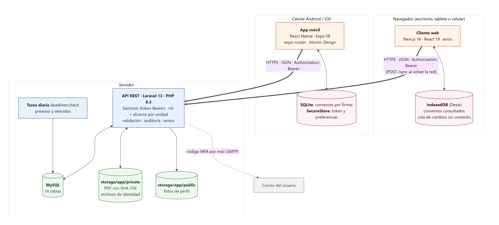
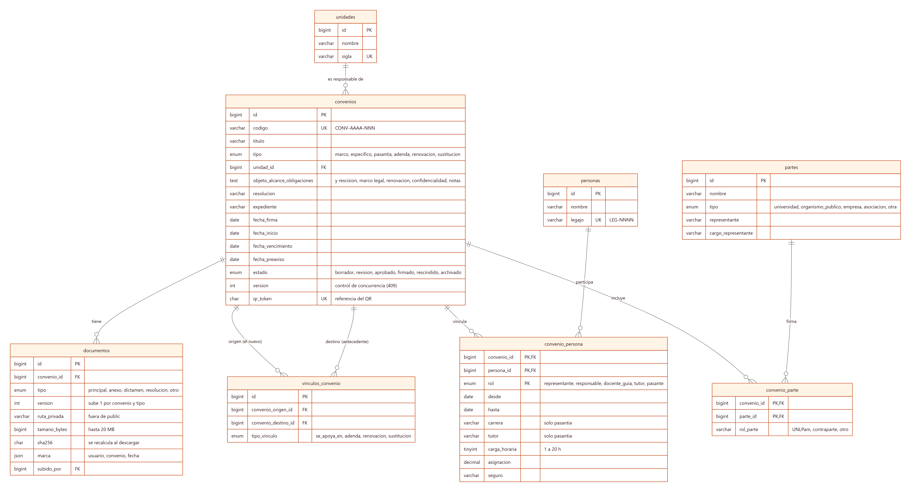
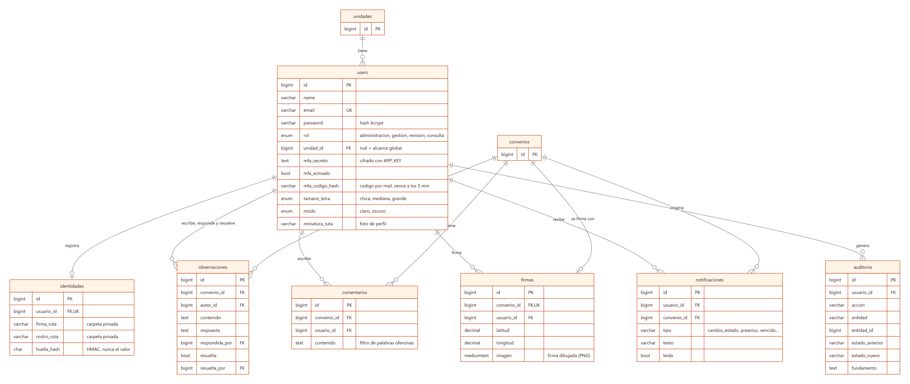
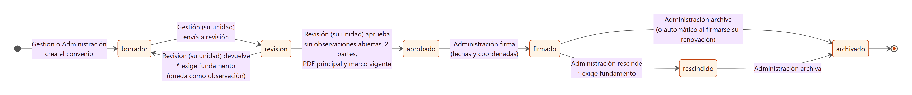
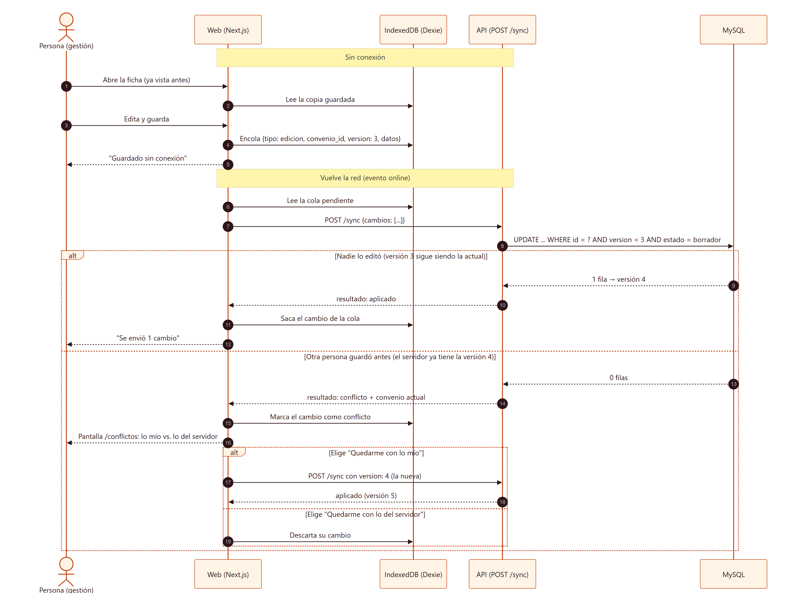

# Informe técnico · Sistema de Gestión de Convenios UNLPam

Trabajo Integrador Final de Programación Orientada a la Web y Laboratorio de Aplicaciones Móviles, 2026.

El sistema tiene tres partes: una plataforma web de gestión, una aplicación móvil y una API REST que comparten las dos. Este informe describe cómo está construido, por qué se tomó cada decisión y cómo instalarlo. Todos los datos son ficticios.

**Contenido**

1. [Arquitectura](#1-arquitectura)
2. [Modelo de datos](#2-modelo-de-datos)
3. [API REST](#3-api-rest)
4. [Matriz de permisos](#4-matriz-de-permisos)
5. [Decisiones de diseño](#5-decisiones-de-diseño)
6. [Estados del trámite](#6-estados-del-trámite)
7. [Trabajo sin conexión, sincronización y conflictos](#7-trabajo-sin-conexión-sincronización-y-conflictos)
8. [Seguridad](#8-seguridad)
9. [Instalación paso a paso](#9-instalación-paso-a-paso)
10. [Pruebas realizadas](#10-pruebas-realizadas)
11. [Limitaciones conocidas](#11-limitaciones-conocidas)

Documentos relacionados, con más detalle: [api.md](api.md) (contrato completo de la API), [permisos.md](permisos.md) (matriz de permisos), [seguridad.md](seguridad.md), [pruebas-api.md](pruebas-api.md), [limitaciones.md](limitaciones.md) y [flujos.md](flujos.md). Los diagramas de este informe se generan a partir de los archivos de [informe/diagramas/](informe/diagramas/), en formato Mermaid, y se pueden editar.

---

## 1. Arquitectura



| Parte | Tecnología | Qué hace |
|---|---|---|
| **Cliente web** | Next.js 16, React 19, axios | Gestión completa: alta y edición de convenios, revisión, auditoría, estadísticas y exportación. Adaptable a escritorio, tableta y celular |
| **IndexedDB** (web) | Dexie 4 | Copia de los convenios consultados y cola de cambios hechos sin conexión |
| **App móvil** | React Native 0.88 con Expo 58, expo-router | Consulta, firma con huella y dibujo, lector QR, sede por ubicación, avisos y PDF |
| **SQLite y SecureStore** (móvil) | expo-sqlite, expo-secure-store | SQLite guarda la lista de convenios por firmar para verla sin red; SecureStore guarda el token y las preferencias cifrados por el sistema operativo |
| **API REST** | Laravel 13, PHP 8.3, Sanctum 4 | Única fuente de las reglas de negocio: valida, controla rol y unidad en cada pedido, registra la auditoría y genera los avisos |
| **MySQL** | MySQL o MariaDB | 16 tablas (sección 2) |
| **storage/app/private** | Disco local de Laravel | PDF de los convenios (con SHA-256 y marca en los metadatos) y archivos de identidad. No tiene URL pública: solo salen por la API |
| **storage/app/public** | Disco público | Fotos de perfil (nombres UUID), con su miniatura |
| **Tarea diaria** | Scheduler de Laravel | `deadlines:check` genera los avisos de preaviso y de convenios vencidos |

**Cómo se comunican.** Los dos clientes hablan con la API por HTTPS, con JSON y el encabezado `Authorization: Bearer <token>`. Ninguno accede a la base ni a los archivos directamente. La exportación devuelve PDF o CSV, y la descarga de documentos devuelve el PDF a través de la API. El código del segundo paso del login llega por mail (SMTP) o se lee en Google Authenticator.

La web y la app usan **la misma API y las mismas reglas**. Por eso un permiso o una validación se cambian en un solo lugar.

---

## 2. Modelo de datos

El modelo parte del borrador de la tarea 1.4 y del diccionario de datos de las tareas 1.6 y 1.7. Los diagramas siguientes son el **modelo actualizado**, tomado de la base real con sus 16 tablas. Se muestran en dos partes para que se puedan leer.

### 2.1 El convenio y lo que cuelga de él



### 2.2 Usuarios y trazabilidad



La tabla `personal_access_tokens` (tokens de Sanctum) no se dibuja: es de la librería.

### 2.3 Reglas del modelo

| Tema | Cómo se representa |
|---|---|
| **Instrumentos nuevos** | Una adenda, renovación o sustitución es **otro convenio**, con código y ficha propios. Se une a su antecedente en `vinculos_convenio`, y el anterior no se modifica. Única excepción: al firmarse una renovación, el convenio renovado pasa a `archivado`, y queda en la auditoría |
| **Relaciones** | `vinculos_convenio` guarda el par (origen, destino) y el tipo. `se_apoya_en` lo usan específicos y pasantías hacia un marco. Las reglas de compatibilidad están en `ReglasVinculos` |
| **Código único** | `CONV-AAAA-NNN`, único en la tabla |
| **Versiones del convenio** | `convenios.version` sube 1 con cada edición. Una edición con una versión vieja se rechaza con 409 (sección 7) |
| **Versiones de documentos** | `documentos.version` sube 1 por convenio y tipo. Las cargas anteriores se conservan |
| **Integridad de documentos** | `sha256` se calcula al subir y se vuelve a calcular al descargar. Si no coincide, la descarga responde 422 "archivo alterado" |
| **Estados** | Lista fija en `convenios.estado`, con cambios solo por los pasos permitidos (sección 6) |
| **Fechas** | `AAAA-MM-DD`. Fecha y hora en ISO 8601 con zona. El preaviso se calcula 60 días antes del vencimiento. Sin vencimiento se muestra "sin vencimiento registrado" |
| **Auditoría** | `auditoria` registra quién, qué, sobre qué y cuándo, con el estado anterior, el nuevo y el fundamento en los cambios de estado. Sus filas no se editan ni se borran |
| **Permisos** | `users.rol` y `users.unidad_id`: sin unidad, el alcance es global; con unidad, solo esa unidad (sección 4) |

### 2.4 Cambios respecto del borrador de la tarea 1.4

| Cambio | Por qué |
|---|---|
| Tabla `users` con `name`, `email` y `password` (el diccionario decía `nombre`, `correo` y `clave_hash`) | Son los nombres que usa Laravel para la autenticación. Se mantuvo a propósito: la API acepta y documenta `nombre`, `correo` y `clave` al crear usuarios |
| `users`: campos de MFA, `tamano_letra`, `modo` y foto de perfil | Segundo paso del login (Google Authenticator o código por mail) y perfil de la app (letra, modo oscuro, foto) |
| Tablas nuevas `firmas` e `identidades` | La firma registra quién, cuándo, dónde (coordenadas) y la imagen dibujada. La identidad guarda firma, rostro y un hash del dispositivo |
| `observaciones`: respuesta, quién respondió y quién resolvió, con fechas | Trazabilidad completa de la revisión, que pide el enunciado |
| `notificaciones`: `texto` y `tipo` libre | Los avisos llevan código, título y dato relevante. El enum original no tenía todos los disparadores |
| `auditoria`: `estado_anterior`, `estado_nuevo` y `fundamento` | Para registrar cada transición con su fundamento |
| `convenios.qr_token` | Referencia aleatoria del QR, sin datos del convenio |
| `documentos.marca` | Marca en los metadatos del PDF: usuario, convenio y fecha |
| Los valores de las listas van sin tildes ni espacios (`especifico`, `docente_guia`, `organismo_publico`) | Evita problemas de codificación entre la base, la API y los clientes. Las pantallas muestran el texto con tildes |

---

## 3. API REST

Todas las rutas empiezan con `/api` y, salvo el login y `/health`, exigen `Authorization: Bearer <token>`. El detalle de cada una (cuerpos, respuestas, reglas y errores) está en [api.md](api.md).

**Errores comunes a toda la API:**

| Código | Cuándo |
|---|---|
| 401 | Sin sesión |
| 403 | El rol no alcanza, o se usa el token limitado del login |
| 404 | No existe **o está fuera de la unidad del usuario**: no se distingue, para no revelar qué hay en otras unidades |
| 405 | Método no permitido |
| 409 | Versión vieja al editar, o dato repetido |
| 422 | Validación, con `errors` por campo |
| 429 | Demasiados intentos |

| Recurso | Método y ruta | Quién | Para qué |
|---|---|---|---|
| Salud | `GET /health` | Público | Saber si el backend responde |
| Auth | `POST /auth/login` | Público (5 por minuto) | Correo y clave; devuelve un token limitado |
| | `POST /auth/mfa/verify` | Token limitado | Código de 6 dígitos; devuelve el token completo |
| | `POST /auth/mfa/send-code` | Token limitado | Manda el código por mail |
| | `GET /auth/me` · `POST /auth/logout` | Autenticado | Quién soy · cerrar sesión |
| Usuarios | `GET /users` · `POST /users` · `PUT /users/{id}` | Administración | Listar, crear y editar usuarios |
| Unidades | `GET /unidades` · `POST /unidades` | Todos · Administración | Facultades y secretarías |
| Convenios | `GET /agreements` | Todos, según alcance | Búsqueda con filtros y paginación |
| | `GET /agreements/{id}` | Todos, según alcance | Ficha |
| | `POST /agreements` · `PUT /agreements/{id}` | Administración; Gestión de su unidad | Crear · editar (con `version`) |
| | `POST /agreements/{id}/transition` | Según el paso | Cambiar de estado |
| | `GET /agreements/export` | Todos, según alcance | Exportar a PDF o CSV |
| Partes | `GET/POST /parties` · `GET/PUT /parties/{id}` | Todos leen; Administración y Gestión escriben | Instituciones firmantes |
| | `POST /agreements/{id}/parties` · `DELETE …/parties/{parte}` | Administración; Gestión de su unidad | Asociar y quitar partes |
| Personas | `GET/POST /people` · `GET/POST /agreements/{id}/people` · `DELETE …/people/{persona}` | Administración, Gestión y Revisión (Consulta no) | Personas vinculadas y datos de pasantía |
| Documentos | `GET/POST /agreements/{id}/documents` | Según alcance; Revisión solo sube dictámenes | Listar y subir PDF |
| | `GET /documents/{id}` · `GET /documents/{id}/download` | Según alcance; Consulta solo firmados | Metadatos y descarga verificada |
| Vínculos | `GET/POST /agreements/{id}/links` · `DELETE …/links/{id}` | Todos leen; Administración y Gestión escriben | Antecedentes y derivados |
| | `GET /agreements/{id}/lifeline` | Todos, según alcance | Línea de vida: toda la cadena, por fecha |
| Estadísticas | `GET /dashboard` | Todos, según alcance | Panel de estadísticas y vencimientos |
| Avisos | `GET /alerts` · `POST /alerts/{id}/read` | Cada usuario, los suyos | Notificaciones |
| Revisión | `GET/POST /agreements/{id}/observations` · `POST /observations/{id}/reply` · `POST /observations/{id}/resolve` | Revisión observa y resuelve; Gestión responde | Observaciones del trámite |
| Comentarios | `GET/POST /agreements/{id}/comments` | Administración, Gestión y Revisión | Notas internas, con filtro de palabras ofensivas |
| Firma | `GET /agreements/to-sign` · `POST /agreements/{id}/sign` | Administración | Pendientes y firma registrada |
| Mi cuenta | `GET/POST /me/identity` · `PUT /me/preferences` · `POST /me/photo` | Autenticado | Identidad, preferencias y foto |
| QR | `POST /agreements/{id}/qr` · `GET /qr/{token}` | Administración y Gestión generan; todos abren según alcance | QR de la ficha |
| Sincronización | `POST /sync` | Autenticado | Cambios hechos sin conexión |
| Auditoría | `GET /audit` | Administración | Registro de acciones |

**Formatos de intercambio:** JSON en toda la API, y CSV y PDF en la exportación. En el CSV, las celdas que empiezan con `=`, `+`, `-` o `@` salen con una comilla simple adelante, para que una planilla no las ejecute como fórmula.

---

## 4. Matriz de permisos

Cuatro roles: administración, gestión, revisión y consulta. La matriz oficial es la de [permisos.md](permisos.md) (tarea 1.5, actualizada). Acá se muestra con más detalle, incluidas las acciones que se sumaron durante el desarrollo: observaciones, comentarios y QR. El servidor la controla en cada pedido, no solo la pantalla: con el middleware `role:` en las rutas, y con el filtro por unidad (`Agreement::visiblesPara`) en cada consulta.

**Alcance:** un usuario **sin unidad** tiene alcance global. Uno **con unidad** solo ve y opera sobre los convenios de esa unidad. Gestión y revisión siempre tienen unidad; administración y consulta pueden tenerla o no.

| Acción | Administración | Gestión | Revisión | Consulta |
|---|---|---|---|---|
| Ver ficha, buscar, ver estadísticas y línea de vida | ✅ según alcance | ✅ su unidad | ✅ su unidad | ✅ según alcance, **sin datos personales, observaciones ni firma** |
| Crear convenio | ✅ | ✅ su unidad | — | — |
| Editar (solo en borrador) | ✅ | ✅ su unidad | — | — |
| Agregar o quitar partes, personas y vínculos | ✅ | ✅ su unidad | — (solo los ve) | — (ve partes y vínculos, no personas) |
| Enviar a revisión | — | ✅ su unidad | — | — |
| Observar, resolver observaciones, aprobar o devolver | — | — | ✅ su unidad | — |
| Responder observaciones | ✅ | ✅ su unidad | — | — |
| Firmar, rescindir, archivar | ✅ | — | — | — |
| Subir documentos | ✅ | ✅ su unidad | ✅ solo dictámenes de su unidad | — |
| Descargar documentos | ✅ | ✅ su unidad | ✅ su unidad | ✅ solo convenios firmados |
| Exportar (PDF o CSV) | ✅ | ✅ su unidad | ✅ su unidad | ✅ según alcance, sin datos personales |
| Comentarios | ✅ | ✅ su unidad | ✅ su unidad | — |
| Generar el QR de la ficha | ✅ | ✅ su unidad | — | — |
| Administrar usuarios y unidades | ✅ | — | — | — |
| Ver auditoría | ✅ | — | — | — |
| Avisos, identidad y perfil | Los propios | Los propios | Los propios | Los propios |

**Criterios detrás de la matriz:**
- **Cada paso del trámite tiene un solo dueño:** gestión carga y envía, revisión observa y aprueba o devuelve, y administración firma. Separar quien carga de quien revisa evita que una misma persona apruebe su propio trabajo.
- **La lectura también se limita por unidad.** Las fichas internas incluyen datos personales, observaciones y la firma, así que gestión y revisión ven solo las de su unidad. Así se minimiza la exposición de datos, como pide el enunciado. Fuera de su alcance, la API responde 404.
- **La auditoría la ve solo administración**, porque registra acciones de todas las personas, incluidas las consultas de datos personales.

La primera versión de la matriz (octubre) daba a gestión y revisión lectura global, dejaba a administración enviar y aprobar, y le daba a revisión la auditoría de su unidad. Se ajustó con estos criterios durante la implementación. El detalle está en [permisos.md](permisos.md), sección "Cambios respecto de la primera versión".

---

## 5. Decisiones de diseño

### Laravel para la API

El enunciado pide PHP/Laravel o Node.js. Se eligió **Laravel 13** porque resuelve con piezas probadas lo que el dominio exige:
- **Sanctum** para tokens con permisos ("abilities"), que permite el login en dos pasos con un token limitado.
- Validación declarativa, con respuestas 422 uniformes.
- Migraciones y seeders, para instalar desde cero de forma reproducible.
- Eloquent con *scopes*, para escribir una sola vez la regla del alcance por unidad.
- Transacciones, para que un cambio de estado, su auditoría y sus avisos se guarden juntos o no se guarde nada.
- El scheduler, para la tarea diaria de vencimientos.

### Next.js para la web

El enunciado pide React/Next.js. Se usa **Next.js 16** con App Router. Las páginas del panel son componentes de cliente, porque la sesión es un token en el navegador (no una cookie que el servidor pueda leer) y casi toda la pantalla depende de datos del usuario. De Next se aprovechan:
- las rutas por carpetas (`/convenios/[id]`, `/revision`, `/auditoria`…);
- la pre-carga de páginas, que permite abrir sin red una ficha ya vista (sección 7).

### Expo para la app móvil

El enunciado pide React Native. **Expo** da acceso, con una API uniforme y sin configurar Android Studio ni Xcode, a lo que la app necesita:
- cámara para el lector QR (`expo-camera`);
- biometría para firmar (`expo-local-authentication`);
- ubicación para reconocer la sede (`expo-location`);
- notificaciones locales (`expo-notifications`);
- base local (`expo-sqlite`) y almacenamiento cifrado (`expo-secure-store`).

Además, la app se prueba en el celular con **Expo Go** escaneando un QR, y `expo-router` define la navegación con archivos, igual que Next.js en la web.

### Atomic Design en la app

El enunciado pide aplicar Atomic Design en al menos una sección. En `mobile/src/components` los componentes están en tres niveles, y **cada nivel solo usa los de abajo**:

| Nivel | Componentes | Ejemplo de regla |
|---|---|---|
| Átomos | `Button`, `Badge`, `LoadingView` | `Button` tiene alto táctil mínimo de 44 px. `Badge` nunca informa el estado solo con color: lleva ícono y texto |
| Moléculas | `SearchBar`, `EmptyView`, `ErrorView`, `Opciones`, `AvisoSinConexion` | `SearchBar` combina un campo y un botón, y avisa con `onBuscar(texto)` sin saber qué se hace con él |
| Organismos | `ConvenioCard`, `ConvenioArbol`, `Comentarios`, `FirmaManuscrita`, `HeaderBuscador`, `MiSede` | `ConvenioCard` reúne `Badge` y `Button` con los datos de un convenio, recibidos por props |

Las pantallas (`src/screens`) arman organismos y moléculas, y todos los componentes toman colores y tamaños de `constants/theme.ts`. Así el **modo oscuro** y el **tamaño de letra** cambian en toda la app desde un solo lugar. Los diagramas de esta composición están en [docs/design/](design/).

### Otras decisiones

| Decisión | Por qué |
|---|---|
| **Token Bearer en el encabezado**, no cookies de sesión | Sirve igual para la web y para la app, y elimina el riesgo de CSRF (sección 8) |
| **Login en dos pasos** (Google Authenticator o código por mail) | El sistema maneja datos personales y firmas. El primer paso entrega un token que solo sirve para el segundo |
| **Fuera de alcance = 404** | No revela qué convenios existen en otras unidades |
| **Una sola regla para los plazos** (`Agreement::situacion`) | Los avisos, el panel y la línea de vida dicen siempre lo mismo sobre un convenio vigente, por vencer o vencido |
| **Firma administrativa** | La firma registra quién, cuándo, dónde y la imagen dibujada, con verificación biométrica en el celular. **No equivale a una firma digital** ni certifica legalidad, como aclara el enunciado |
| **Innovación: línea de vida** | Muestra toda la cadena de un convenio (marco, específicos, adendas, renovaciones) en una línea de tiempo, con la situación de cada tramo. Resuelve un problema detectado en la Referencia 2 (UNLu): las relaciones entre convenios eran solo texto, sin enlace al de origen |

---

## 6. Estados del trámite



| Desde → hacia | Quién | Exige |
|---|---|---|
| (nuevo) → borrador | Gestión o Administración | Ficha válida |
| borrador → revisión | Gestión (su unidad) | — |
| revisión → borrador (devolver) | Revisión (su unidad) | **Fundamento escrito**, que además queda como observación para que gestión la responda |
| revisión → aprobado | Revisión (su unidad) | Ninguna observación sin resolver, al menos **2 partes**, el **PDF principal** y, en específicos y pasantías, el **marco firmado y vigente** |
| aprobado → firmado | Administración | Fechas de firma e inicio. Con la **firma registrada** (`POST /agreements/{id}/sign`) se exigen además las coordenadas, la imagen dibujada es opcional y, si no se mandan fechas, se toma el día de hoy |
| firmado → rescindido | Administración | **Fundamento escrito** |
| firmado o rescindido → archivado | Administración | — (automático para el convenio anterior cuando se firma su renovación) |

Cada transición queda en la auditoría con usuario, fecha, estado anterior, estado nuevo y fundamento, y genera avisos a las personas que corresponde. Un paso no permitido responde 422; un rol que no puede darlo, 403.

Solo se edita en **borrador**. Desde revisión en adelante, un cambio se hace con un instrumento nuevo (adenda), como pide el dominio. La aprobación es un paso **administrativo**: no es firma digital ni certificación de legalidad.

---

## 7. Trabajo sin conexión, sincronización y conflictos

### Web: IndexedDB

La web usa **IndexedDB** a través de Dexie, con dos tablas:

| Tabla | Qué guarda |
|---|---|
| `convenios` | Cada ficha que se abre (datos, vínculos, documentos, observaciones y línea de vida). Sin red, se muestra esa copia con el aviso "Sin conexión" y la fecha en que se guardó |
| `cambios` | La cola de ediciones hechas sin red: `{id_cliente, tipo, convenio_id, version, datos}` y su estado (`pendiente`, `conflicto` o `rechazado`) |

Al cerrar sesión se borra todo, para que en una computadora compartida no quede nada de la persona anterior.

### Móvil: SQLite y SecureStore

La app guarda en **SQLite** la lista de convenios por firmar, para verla sin red. El token y las preferencias van en **SecureStore**. Cuando no hay red, avisa con una franja visible y bloquea las acciones que necesitan al servidor (comentar o firmar), en lugar de fallar.

### Sincronización



Cuando el navegador recupera la red (evento `online`), y también al abrir la app, la web manda la cola a `POST /sync`. Lo aplicado sale de la cola y se avisa con "Se envió 1 cambio". Lo que queda en conflicto lleva a la pantalla **/conflictos**.

### Regla de conflictos

- **Ediciones del convenio: control optimista por versión.** El servidor aplica la edición solo si la `version` que tenía el cliente sigue siendo la actual y el convenio sigue en borrador. El `UPDATE` exige las dos condiciones en una sola operación, así que dos pedidos simultáneos no pueden pisarse. Si no coinciden, **no se sobrescribe nada**: el servidor devuelve `conflicto` con el convenio como está hoy.
- **La persona decide.** La pantalla de conflictos muestra, campo por campo, "lo mío (sin conexión)" frente a "lo del servidor".
  - **Quedarme con lo mío:** se reenvía sobre la versión nueva del servidor.
  - **Quedarme con lo del servidor:** se descarta el cambio local.

  Si el convenio ya salió de borrador, solo se puede descartar.
- **Comentarios: siempre se aplican.** Solo agregan, no reemplazan el trabajo de nadie.

Se descartó la regla "gana el último que guarda" porque borraría en silencio el trabajo de otra persona, y el enunciado pide impedirlo. Es la misma regla que usa la edición con conexión (`PUT /agreements/{id}` responde 409), así que la web y el móvil se comportan igual con o sin red.

---

## 8. Seguridad

El detalle de cada punto, con la prueba que lo verifica, está en [seguridad.md](seguridad.md).

- **Autenticación en toda la API**, salvo login y `/health`. En la revisión de seguridad se probaron las 50 rutas que había sin token, y 48 respondieron 401. Las que se agregaron después (usuarios y unidades) también lo exigen y están en la colección de pruebas.
- **Login en dos pasos**:
  - El token del primer paso solo sirve para el segundo (403 en el resto).
  - El login admite 5 intentos por minuto por correo e IP.
  - El código MFA se anula a los 5 intentos fallidos.
- **Rol y unidad en el servidor**: middleware de rol en las rutas y filtro por unidad en búsquedas, fichas, estadísticas, exportación, descargas y personas.
- **CORS** limitado a la web del proyecto (configurable en `CORS_ALLOWED_ORIGINS`).
- **CSRF**: el token viaja en el encabezado `Authorization`, que el navegador nunca agrega por su cuenta. Un sitio ajeno no puede armar un pedido válido, y no hay cookies de sesión. El token Bearer cumple la función que el token CSRF cumple en una app con cookies.
- **Documentos protegidos**:
  - Fuera de la carpeta pública.
  - Solo PDF reales de hasta 20 MB.
  - SHA-256 verificado en cada descarga.
  - Marca en los metadatos.
  - Cada descarga queda auditada.
- **Datos guardados con hash o cifrado**:
  - contraseñas: bcrypt;
  - tokens de sesión: SHA-256;
  - secreto de Google Authenticator: cifrado;
  - huella del dispositivo: HMAC.

  Nada de eso sale en las respuestas.
- **Privacidad**: datos ficticios; consulta no ve datos personales; ver personas queda auditado; el QR lleva una referencia aleatoria, no datos.
- **Exportación segura**: las celdas que una planilla podría ejecutar como fórmula se neutralizan.

---

## 9. Instalación paso a paso

### 9.1 Requisitos

| Herramienta | Versión | Para qué |
|---|---|---|
| PHP | 8.3 o superior, con las extensiones `pdo_mysql`, `mbstring`, `fileinfo`, `gd`, `zip` y `openssl` | Backend |
| Composer | 2 | Dependencias del backend |
| MySQL o MariaDB | MySQL 8 o MariaDB 10.6 o superior (probado con MariaDB 10.11, la de XAMPP) | Base de datos |
| Node.js | 20.9 o superior (probado con 24) | Web y app |
| Git | — | Clonar el repositorio |
| Celular con **Expo Go**, o emulador Android | — | Probar la app |

**En Windows con XAMPP:** en `C:\xampp\php\php.ini`, sacar el `;` de `extension=gd` (hace falta para las fotos de perfil) y reiniciar.
**En Linux (Ubuntu/Debian):** `sudo apt install php8.3-mysql php8.3-mbstring php8.3-xml php8.3-gd php8.3-zip php8.3-curl`.

### 9.2 Base de datos

Con MySQL andando (en XAMPP: botón *Start* de MySQL), crear la base vacía:

```sql
CREATE DATABASE convenios_unlpam CHARACTER SET utf8mb4 COLLATE utf8mb4_unicode_ci;
```

Se puede hacer desde phpMyAdmin (`http://localhost/phpmyadmin`) o con `mysql -u root -e "…"`.

### 9.3 Backend (API)

```bash
git clone https://github.com/mseibelcastello/convenios_unlpam.git
cd convenios_unlpam/backend
composer install
cp .env.example .env          # en Windows: copy .env.example .env
php artisan key:generate
```

Revisar en `backend/.env` los datos de la base (`DB_DATABASE`, `DB_USERNAME`, `DB_PASSWORD`; con XAMPP, `root` sin clave). Después:

```bash
php artisan migrate --seed      # crea las tablas y carga los datos de prueba (solo la primera vez)
php artisan storage:link        # enlace para las fotos de perfil
php artisan serve --host=0.0.0.0 --port=8000
```

Comprobar: `http://localhost:8000/api/health` tiene que responder `{"ok":true}`.

`--host=0.0.0.0` hace falta para que el celular llegue al backend por la red local.

### 9.4 Usuarios de prueba y código de acceso

Todos tienen la clave **`password`**:

| Usuario | Rol | Unidad |
|---|---|---|
| `admin@demo.test` | Administración | Todas |
| `gestion@demo.test` | Gestión | FCEyN |
| `revision@demo.test` | Revisión | FCEyN |
| `consulta@demo.test` | Consulta | Todas |
| `gestion.fi@demo.test`, `revision.fi@demo.test`, `consulta.fi@demo.test` | Gestión, Revisión, Consulta | Ingeniería |
| `gestion.fa@demo.test` (y `.fceyj`, `.fceyn`, `.fch`, `.fcs`, `.fcv`) | Gestión | Cada facultad |

**El segundo paso del login** se resuelve de dos formas:
- **Google Authenticator** (o cualquier app TOTP): en el primer ingreso de cada usuario aparece un QR para escanear.
- **Código por mail:** el botón "Enviarme el código a mi mail". Con `MAIL_MAILER=log` (el valor de `.env.example`) no se manda nada, y el código aparece en `backend/storage/logs/laravel.log`, en la línea "MFA simulado". Para recibirlo de verdad, configurar el SMTP en `.env` (`MAIL_MAILER=smtp`, `MAIL_HOST`, `MAIL_USERNAME`, `MAIL_PASSWORD`…).

### 9.5 Web

En otra terminal:

```bash
cd convenios_unlpam/web
npm install
npm run dev
```

Abrir `http://localhost:3000`. La web usa la API en `http://localhost:8000/api`; para cambiarla, definir `NEXT_PUBLIC_API_URL`.

Para probar el **modo sin conexión** hace falta la versión de producción: `npm run build` y después `npm run start` (sección 11).

### 9.6 App móvil

```bash
cd convenios_unlpam/mobile
npm install
```

Crear `mobile/.env` con la IP de la computadora en la red local. En Windows se ve con `ipconfig`; en Linux, con `hostname -I`.

```
EXPO_PUBLIC_API_URL=http://192.168.1.20:8000/api
```

En el emulador de Android no hace falta: usa `10.0.2.2` por defecto. Después:

```bash
npx expo start -c
```

Escanear el QR con **Expo Go** (Android) o con la cámara (iPhone). El celular y la computadora tienen que estar en la misma red Wi-Fi. Si Windows pregunta por el firewall, permitir PHP y Node en redes privadas.

### 9.7 Tarea diaria de vencimientos

Para que los avisos de preaviso y vencidos se generen solos, dejar corriendo `php artisan schedule:work` (desarrollo) o agregar `php artisan schedule:run` a un cron cada minuto (servidor). Para correrla a mano: `php artisan deadlines:check`.

### 9.8 Atajos (scripts de inicio)

Una vez hecha la instalación (con `migrate --seed` corrido al menos una vez), en la carpeta principal:

| Script | Qué hace |
|---|---|
| `iniciar-web.bat` (Windows) o `iniciar-web.sh` (Linux) | Revisa MySQL, instala dependencias, corre migraciones, crea el enlace de storage y levanta backend y web en ventanas separadas (más una con los códigos de login) |
| `iniciar-movil.bat` o `iniciar-movil.sh` | Detecta la IP y levanta Expo apuntando a ese backend |

Los scripts **no cargan los usuarios de demostración**: la primera vez hay que correr `php artisan migrate --seed` como en 9.3.

---

## 10. Pruebas realizadas

| Qué | Cómo | Resultado |
|---|---|---|
| **Toda la API contra el contrato** | Colección de Postman ([coleccion-api.postman.json](coleccion-api.postman.json)) con una petición por endpoint, el caso correcto y al menos un error. Corrida con Newman contra el backend con los datos de prueba | **111 peticiones, 193 verificaciones, todas pasan**. La primera corrida encontró 11 diferencias, que se corrigieron en la API o en el contrato. Detalle en [pruebas-api.md](pruebas-api.md) |
| **Seguridad** | Lista de control: rutas sin token, CORS, límite de login, filtro por unidad, `.env`, contraseñas | Los 7 puntos verificados con pedidos reales, incluido un navegador real para CORS. Detalle en [seguridad.md](seguridad.md) |
| **Web sin conexión** | Navegador real (Edge) automatizado, con la red cortada como en las herramientas de desarrollo | Una ficha ya vista se abre sin red, con el aviso "Sin conexión"; una no vista avisa que no hay copia |
| **Sincronización y conflictos** | El mismo navegador: edición sin red, otra persona edita en el servidor y vuelve la red | El cambio sin conflicto se aplicó solo. El conflicto mostró "lo mío vs. lo del servidor", y al elegir "lo mío" el servidor quedó con esa versión |
| **Campana de avisos, QR, línea de vida, panel de revisión y auditoría** | Navegador real, con usuarios de distintos roles y unidades | Cada uno lleva a la ficha correcta, respeta el alcance y se puede usar con teclado. La línea de vida se recorre con las flechas |
| **Instalación desde cero** | Los pasos 9.2 y 9.3 sobre una base vacía nueva | `migrate --seed` crea todas las tablas y los datos de prueba: 13 usuarios, 31 convenios y 10 unidades. `admin@demo.test` entra con la clave `password` |
| **Accesibilidad de los componentes web nuevos** | Uso solo con teclado en el navegador automatizado, y revisión del código | Foco visible, navegación con flechas en la línea de vida, `aria-current` en el elemento actual, y estados que se dicen con texto y no solo con color. No se probó con un lector de pantalla real |

Las pruebas de la **app móvil** y la **prueba de usabilidad con usuarios** (tarea 5.5) las documenta la otra integrante del equipo; este informe no las repite.

---

## 11. Limitaciones conocidas

La lista completa, con por qué pasa cada cosa y qué haría falta, está en [limitaciones.md](limitaciones.md). Las principales:

- **Mensajes de validación en inglés.** Los errores 422 de Laravel no están traducidos; los mensajes propios del sistema sí están en castellano.
- **Los tokens de sesión no vencen.** Se cierran al salir o al cambiar la clave. Para producción hay que definir un vencimiento compatible con el uso sin conexión.
- **Sin conexión, solo convenios ya abiertos y navegando dentro de la web.** Recargar la página sin red necesitaría un service worker (PWA). Además, sin red solo se editan los datos de la ficha; partes, documentos y vínculos necesitan conexión.
- **`POST /sync` puede duplicar un comentario** si el cliente reintenta el mismo envío. Las ediciones no se duplican.
- **La web no tiene pantalla de usuarios.** La API (`/users`) existe, pero la administración de usuarios todavía no tiene interfaz.
- **Producción:** falta `APP_DEBUG=false`, HTTPS y el dominio real en CORS (ver [seguridad.md](seguridad.md)).
